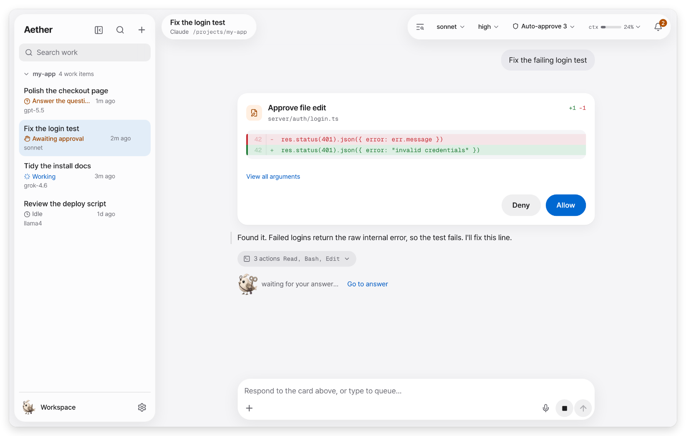
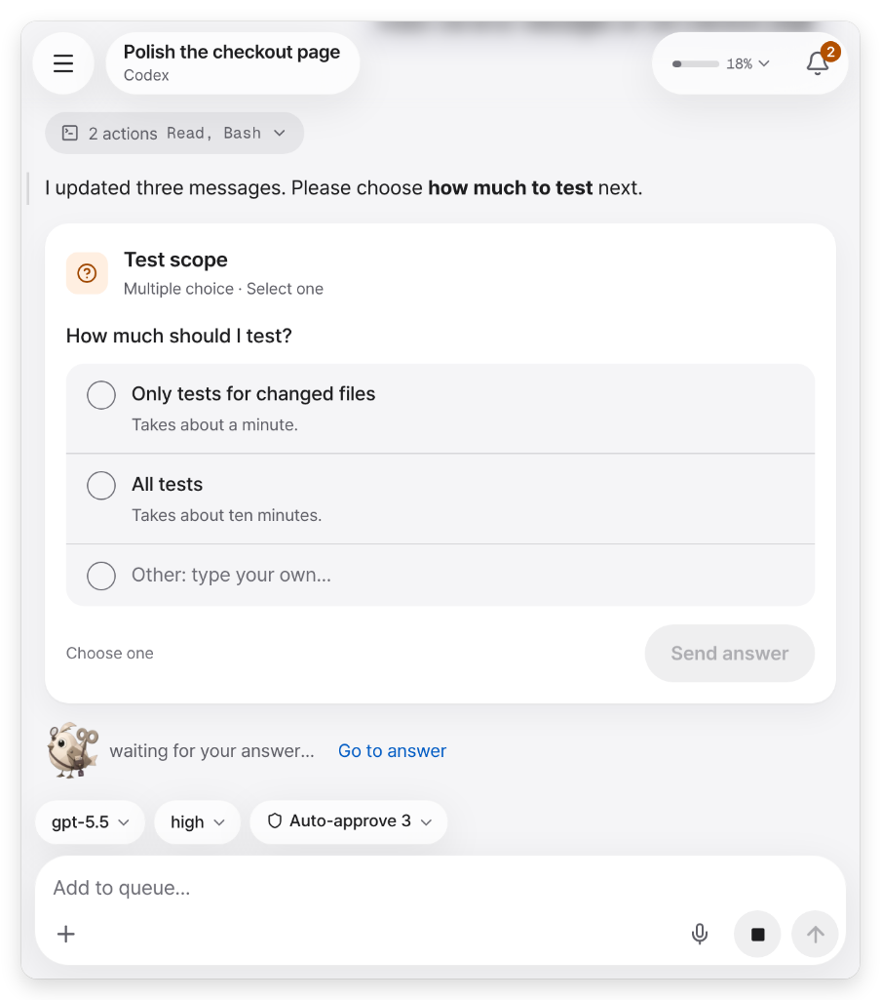
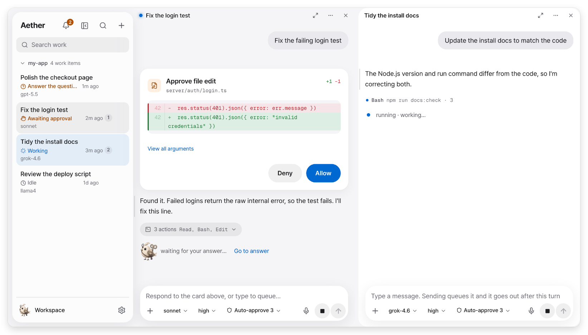
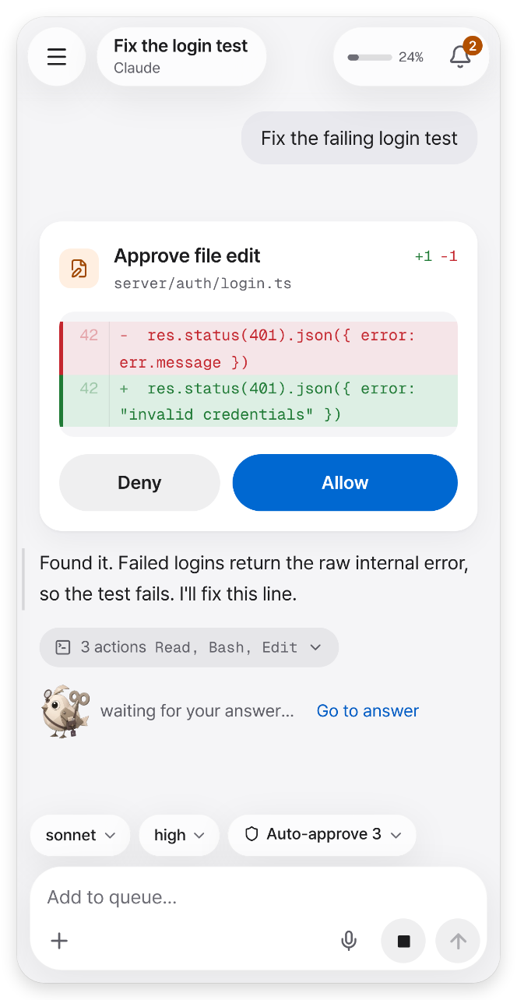

<p align="center">
  
</p>

<h1 align="center">Aether</h1>

<p align="center">
  <strong>A self-hosted chat window for AI coding agents</strong>
</p>

<p align="center">
  <a href="README.md">한국어</a> · English
</p>

<p align="center">
  <a href="LICENSE"></a>
  
</p>

<p align="center">
  <picture>
    <source media="(prefers-color-scheme: dark)" srcset="deploy/readme/hero-en-dark.png">
    
  </picture>
</p>

Aether is an app you install on your own computer. Instead of watching a terminal, you hand work to AI agents in a chat window and answer their questions and approval requests right there. There is nothing to sign up for, and conversations are stored on your computer.

## Who it is for

- You use AI agents in a terminal, but watching the screen all the time is hard.
- You run several pieces of work at once and do not want to miss the one waiting for you.
- You would rather keep conversations on your computer without creating an account.

## Features

- **A chat window, not a terminal** — Files the AI read and commands it ran appear as cards.
- **No account, on your own computer** — Conversations are stored on your computer, and you can back them up and restore them in Settings.
- **See what is waiting, at a glance** — The list shows which work is waiting for you and for how long.
- **Several AIs, one window** — Choose the AI for each piece of work and keep several open side by side.

##  A look around

<table>
<tr>
<td width="42%" valign="middle">

### Answer in place

When the AI asks a question or needs approval, a card appears in the conversation. Pick an option or type your own answer.

</td>
<td width="58%"><picture><source media="(prefers-color-scheme: dark)" srcset="deploy/readme/question-en-dark.png"></picture></td>
</tr>
<tr>
<td colspan="2">

### Several AIs, side by side

Choose the AI for each piece of work, and keep several open side by side.

<picture><source media="(prefers-color-scheme: dark)" srcset="deploy/readme/split-en-dark.png"></picture>

</td>
</tr>
<tr>
<td width="42%" align="center"><picture><source media="(prefers-color-scheme: dark)" srcset="deploy/readme/phone-en-dark.png"></picture></td>
<td width="58%" valign="middle">

### The same screen on your phone

By default, Aether opens only on the computer it is installed on. Connect it yourself through a VPN such as Tailscale, and you can use the same screen in your phone browser.

</td>
</tr>
</table>

The projects and conversations in these screenshots are made-up examples.

## Supported AI tools

Aether does not include any AI tool. Install and sign in to the ones you want to use first. Checking each service's terms of use is up to you.

- Claude Code
- Codex
- Grok
- Ollama

##  Getting started

Node.js 24 is required. From the repository root, run it from source:

```bash
npm --prefix web ci --include=dev
npm --prefix web run build
npm --prefix server ci --include=dev
npm --prefix server start
```

Open <http://127.0.0.1:8787> in your browser. To change settings, copy [`server/.env.example`](server/.env.example) to `server/.env` and edit it.

Run the tests with:

```bash
npm --prefix server test
```

## Access and security

- **By default:** Aether is reachable only from the computer it is installed on, and sign-in is off.
- **From other devices:** Do not expose it directly to the internet. Use a VPN such as Tailscale, and turn on authentication with `AETHER_AUTH_MODE` in `server/.env`. See [`server/.env.example`](server/.env.example) for the options.
- **Be careful:** AI agents can edit files and run commands on this computer. Check your approval settings before you use it.

## License

Code is licensed under the [Apache License 2.0](LICENSE). Third-party notices are in [`NOTICE`](NOTICE).

The Chamding mascot and the Aether name and logos are not covered by this license. To distribute a modified version, replace those files and use a different name. See [`BRAND.md`](BRAND.md) for details.
