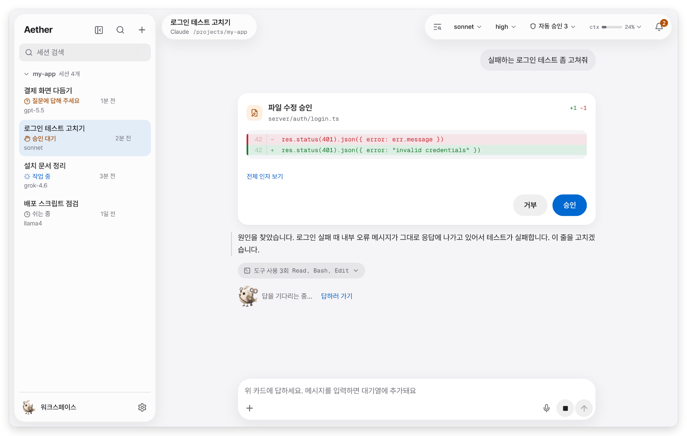
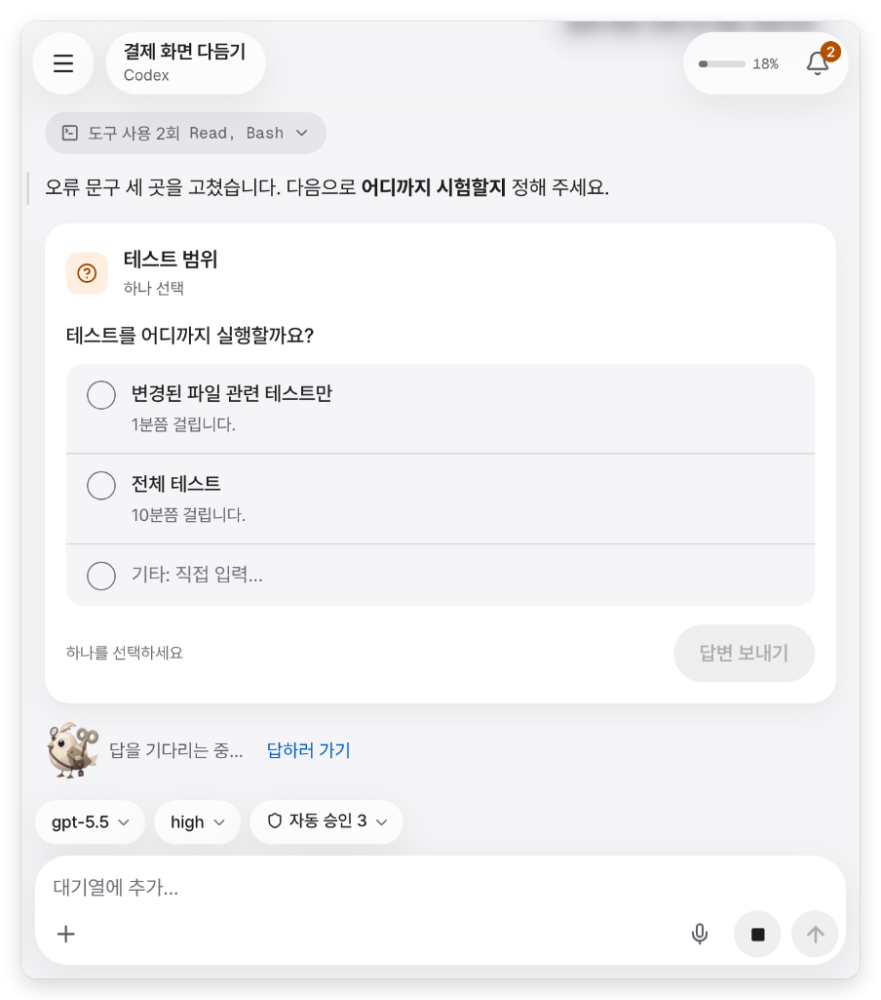
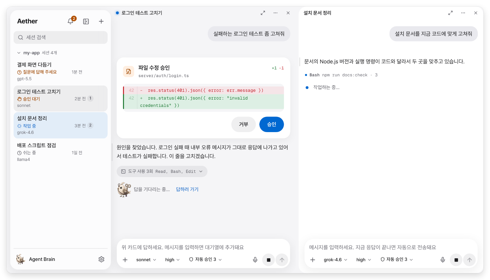
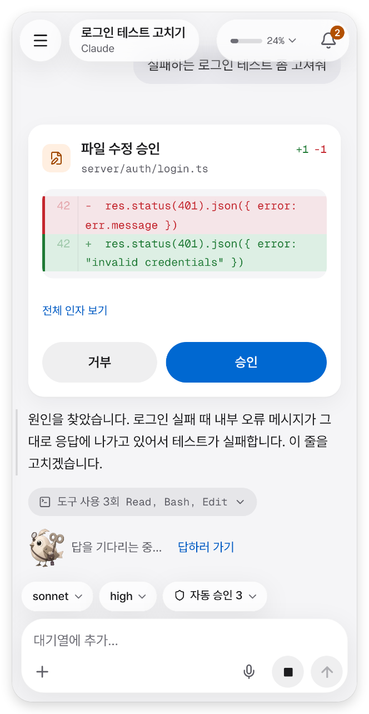

<p align="center">
  
</p>

<h1 align="center">Aether</h1>

<p align="center">
  <strong>터미널 대신 채팅으로 다루는 AI 에이전트</strong>
</p>

<p align="center">
  한국어 · <a href="README.en.md">English</a>
</p>

<p align="center">
  <a href="LICENSE"></a>
  
</p>

<p align="center">
  <picture>
    <source media="(prefers-color-scheme: dark)" srcset="deploy/readme/hero-ko-dark.png">
    
  </picture>
</p>

Aether는 내 컴퓨터에 설치해 쓰는 앱입니다. 터미널을 지켜보는 대신 채팅 화면에서 AI 에이전트에게 작업을 맡기고, 질문과 승인 요청에 바로 답합니다.

## 특징

- **터미널 대신 채팅 화면** — AI가 읽은 파일과 실행한 명령이 카드로 표시됩니다.
- **계정 없이 내 컴퓨터에서** — 회원가입이 필요 없고, 대화 기록은 내 컴퓨터에 저장되고, 설정 화면에서 백업과 복원도 할 수 있습니다.
- **기다리는 작업을 한눈에** — 어떤 작업이 얼마나 오래 내 답을 기다리는지 목록에서 바로 확인할 수 있습니다.
- **여러 AI를 한 화면에서** — 작업마다 AI를 고르고 여러 작업을 나란히 열어 둘 수 있습니다.

##  스크린샷

<table>
<tr>
<td width="42%" valign="middle">

### 답할 일은 카드로

AI가 질문하거나 승인을 요청하면 대화 안에 카드가 뜹니다. 고르거나 직접 입력해서 그 자리에서 답하면 됩니다.

</td>
<td width="58%"><picture><source media="(prefers-color-scheme: dark)" srcset="deploy/readme/question-ko-dark.png"></picture></td>
</tr>
<tr>
<td colspan="2">

### 여러 AI를 나란히

서로 다른 AI에게 맡긴 작업을 나란히 열어 두고 함께 볼 수 있습니다.

<picture><source media="(prefers-color-scheme: dark)" srcset="deploy/readme/split-ko-dark.png"></picture>

</td>
</tr>
<tr>
<td width="42%" align="center"><picture><source media="(prefers-color-scheme: dark)" srcset="deploy/readme/phone-ko-dark.png"></picture></td>
<td width="58%" valign="middle">

### 폰에서도 같은 화면

기본 설정에서는 설치한 컴퓨터에서만 열립니다. Tailscale 같은 VPN으로 직접 연결하면 폰 브라우저에서도 같은 화면을 쓸 수 있습니다.

</td>
</tr>
</table>

이 문서의 화면에 나오는 프로젝트와 대화는 설명을 위해 지어낸 예시입니다.

## 지원하는 AI 도구

Aether에는 AI 도구가 포함되어 있지 않습니다. 아래 중 쓸 도구를 먼저 설치하고 로그인하세요. 각 서비스의 이용 약관은 사용자가 직접 확인해야 합니다.

- Claude Code
- Codex
- Grok
- Ollama

##  시작하기

Node.js 24가 필요합니다. 소스에서 이렇게 실행합니다.

```bash
npm --prefix web ci --include=dev
npm --prefix web run build
npm --prefix server ci --include=dev
npm --prefix server start
```

브라우저에서 <http://127.0.0.1:8787>을 엽니다. 설정은 [`server/.env.example`](server/.env.example)을 `server/.env`로 복사해 고칩니다.

테스트는 이 명령으로 실행합니다.

```bash
npm --prefix server test
```

## 접속 범위와 보안

- **기본값:** 설치한 컴퓨터에서만 접속되고, 로그인 절차는 꺼져 있습니다.
- **다른 기기에서 쓸 때:** 인터넷에 직접 열지 말고 Tailscale 같은 VPN을 쓰고, `server/.env`의 `AETHER_AUTH_MODE`로 인증을 켜세요. 인증 설정은 [`server/.env.example`](server/.env.example)을 보세요.
- **주의:** AI 에이전트는 이 컴퓨터에서 파일을 고치고 명령을 실행할 수 있습니다. 승인 설정을 확인하고 쓰세요.

## 라이선스

코드는 [Apache License 2.0](LICENSE)으로 제공합니다. 함께 들어 있는 외부 저작물은 [`NOTICE`](NOTICE)에 적었습니다.

Aether의 이름과 로고, 캐릭터 그림은 이 라이선스에 포함되지 않습니다. 수정한 버전을 배포하려면 해당 파일을 바꾸고 다른 이름을 써야 합니다. 자세한 내용은 [`BRAND.md`](BRAND.md)를 보세요.
